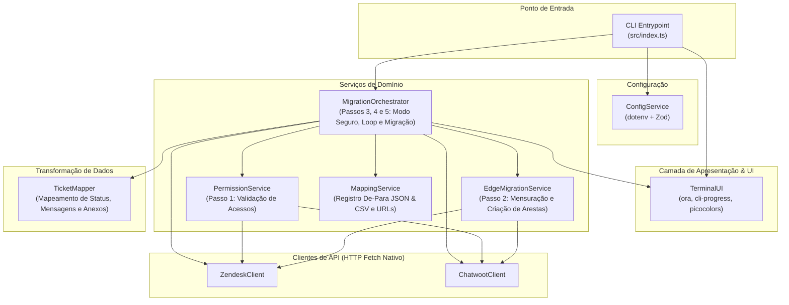

# Design: Zendesk to Chatwoot Ticket Migration Tool

## Architecture Overview

A arquitetura do projeto é baseada em Programação Orientada a Objetos (POO), com forte encapsulamento, responsabilidade única por classe (SOLID) e documentação extensiva em JSDoc (pt-BR).

## Dependency Paths (from nexspec)

- `REQ-MIG-001` → `ConfigService` (`src/config/env.ts`)
- `REQ-MIG-002` → `PermissionService` (`src/services/permission-service.ts`)
- `REQ-MIG-003` → `EdgeMigrationService` (`src/services/edge-migration-service.ts`)
- `REQ-MIG-004` → `MigrationOrchestrator` (`src/services/migration-orchestrator.ts`)
- `REQ-MIG-005` → `MigrationOrchestrator` (`src/services/migration-orchestrator.ts`)
- `REQ-MIG-006` → `TicketMapper` (`src/mappers/ticket-mapper.ts`) → `ChatwootClient` (`src/clients/chatwoot-client.ts`)
- `REQ-MIG-007` → `ZendeskClient` (`src/clients/zendesk-client.ts`)
- `REQ-MIG-008` → `TerminalUI` (`src/ui/terminal-ui.ts`)
- `REQ-MIG-009` → Todas as classes e interfaces do projeto

## Classes e Responsabilidades

### 1. `TerminalUI` (`src/ui/terminal-ui.ts`)

- **Responsabilidade**: Gerencia a renderização de elementos interativos no terminal.
- **Métodos**:
  - `startSpinner(message: string): void`
  - `succeedSpinner(message: string): void`
  - `failSpinner(message: string): void`
  - `createProgressBar(total: number, title?: string): ProgressBar`
  - `updateProgressBar(current: number, tokens?: object): void`
  - `stopProgressBar(): void`
  - `printBanner(): void`
  - `printSummary(stats: MigrationStats): void`
  - `logWarning(message: string): void`
  - `logError(message: string, error?: unknown): void`

### 2. `ConfigService` (`src/config/env.ts`)

- **Responsabilidade**: Carrega variáveis do arquivo `.env` e valida com esquema Zod tipado.
- **Métodos**:
  - `static getInstance(): ConfigService`
  - `get(): AppConfig`
  - `isSingleTicketMode(): boolean`
  - `getTargetTicketId(): number | null`

### 3. `ZendeskClient` (`src/clients/zendesk-client.ts`)

- **Responsabilidade**: Encapsula chamadas HTTP à API v2 do Zendesk.
- **Métodos**:
  - `getCurrentUser(): Promise<ZendeskUser>`
  - `verifyPermissions(): Promise<boolean>`
  - `getTicket(id: number): Promise<ZendeskTicket | null>`
  - `getTicketComments(ticketId: number): Promise<ZendeskComment[]>`
  - `getUser(userId: number): Promise<ZendeskUser>`
  - `downloadAttachment(contentUrl: string): Promise<Blob | null>`
  - `getTicketWebUrl(ticketId: number): string`
  - `listTags(): Promise<ZendeskTag[]>`
  - `listGroups(): Promise<ZendeskGroup[]>`
  - `searchTicketsWithoutTag(tag: string, page?: number): Promise<ZendeskSearchResponse>`
  - `addTagToTicket(ticketId: number, tag: string): Promise<void>`
  - `removeTagFromTicket(ticketId: number, tag: string): Promise<void>`

### 4. `ChatwootClient` (`src/clients/chatwoot-client.ts`)

- **Responsabilidade**: Encapsula chamadas HTTP à API de aplicação do Chatwoot.
- **Métodos**:
  - `verifyAdminAccess(): Promise<boolean>`
  - `listLabels(): Promise<ChatwootLabel[]>`
  - `createLabel(title: string, color?: string): Promise<ChatwootLabel>`
  - `listTeams(): Promise<ChatwootTeam[]>`
  - `createTeam(name: string, description?: string): Promise<ChatwootTeam>`
  - `findContactByEmail(email: string): Promise<ChatwootContact | null>`
  - `createContact(data: CreateContactDTO): Promise<ChatwootContact>`
  - `createConversation(data: CreateConversationDTO): Promise<ChatwootConversation>`
  - `createMessage(conversationId: number, data: CreateMessageDTO, attachments?: MessageAttachmentPayload[]): Promise<ChatwootMessage>`
  - `toggleStatus(conversationId: number, status: string): Promise<void>`
  - `getConversationWebUrl(conversationId: number): string`

### 5. `PermissionService` (`src/services/permission-service.ts`)

- **Responsabilidade**: Executa o Passo 1 do fluxo.
- **Métodos**:
  - `validatePermissions(): Promise<PermissionValidationResult>`

### 6. `EdgeMigrationService` (`src/services/edge-migration-service.ts`)

- **Responsabilidade**: Executa o Passo 2 do fluxo (mensuração e sincronização de arestas: tags, grupos).
- **Métodos**:
  - `assessEdges(): Promise<EdgeAssessmentResult>`
  - `migrateEdges(assessment: EdgeAssessmentResult): Promise<EdgeMigrationResult>`

### 7. `MappingService` (`src/services/mapping-service.ts`)

- **Responsabilidade**: Persiste de forma atômica e estruturada o de-para de chamados migrados (`logs/migration-mapping.json` e `logs/migration-mapping.csv`).
- **Métodos**:
  - `recordMapping(entry: MigrationMappingEntry): void`
  - `getMapping(zendeskTicketId: number): MigrationMappingEntry | undefined`
  - `getAllMappings(): MigrationMappingEntry[]`

### 8. `TicketMapper` (`src/mappers/ticket-mapper.ts`)

- **Responsabilidade**: Converte entidades do Zendesk para o formato esperado pelo Chatwoot.
- **Métodos**:
  - `mapStatus(zendeskStatus: string): 'open' | 'pending' | 'resolved'`
  - `formatMessageContent(comment: ZendeskComment, author: ZendeskUser): string`
  - `extractAttachmentSummary(comment: ZendeskComment): string`

### 8. `MigrationOrchestrator` (`src/services/migration-orchestrator.ts`)

- **Responsabilidade**: Coordena todo o fluxo (Passos 1 a 5).
- **Métodos**:
  - `run(): Promise<void>`
  - `private executeSingleTicket(ticketId: number): Promise<void>`
  - `private executeBatchLoop(): Promise<void>`
  - `private processTicket(ticket: ZendeskTicket): Promise<boolean>`

## Decision Log

- [2026-10-20] Adoção de POO estrita em TypeScript com JSDocs em português para facilitar manutenção e entendimento da equipe.
- [2026-10-20] Uso conjunto de `ora` para operações pontuais (autenticação e arestas) e `cli-progress` para a barra contínua de migração de tickets.
- [2026-10-20] Validação de existência do chamado antes de qualquer escrita no modo seguro de produção.
- [2026-10-20] Tag `chatwoot` inserida no Zendesk como critério de corte da query `type:ticket -tags:chatwoot`.
